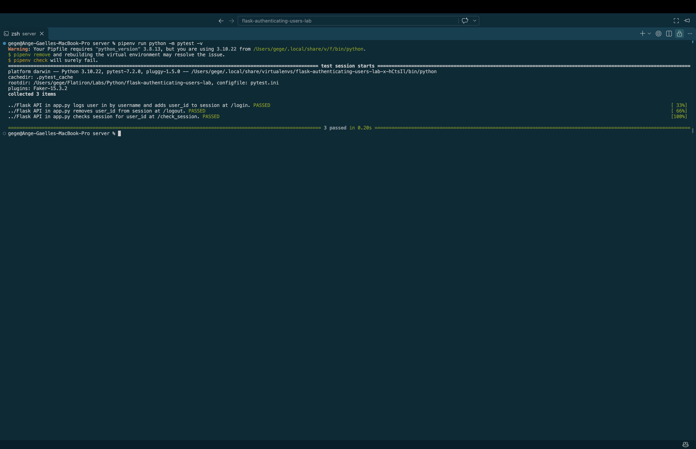

# Flask Authenticating Users Lab

## Overview

This project implements session-based user authentication in a Flask and React article application. Users can log in using their username, remain logged in across HTTP requests, and log out.

The purpose of this lab is to understand how Flask sessions can be used to manage user authentication and maintain application state.

## Learning Objectives

- Understand session-based authentication.
- Use Flask-RESTful to create API resources.
- Retrieve user information from a database.
- Store and retrieve user IDs using Flask sessions.
- Maintain authentication across HTTP requests.
- Implement login, logout, and session verification endpoints.
- Serialize database objects using Marshmallow.
- Test authentication functionality using pytest.

## Technologies Used

- Python 3.10
- Flask
- Flask-RESTful
- Flask-SQLAlchemy
- Flask-Migrate
- Marshmallow
- SQLite
- Faker
- React
- Pipenv
- pytest

## Features

- Log in using an existing username.
- Store the authenticated user's ID in a session.
- Maintain login state across page refreshes.
- Retrieve authenticated user information.
- Return a 401 Unauthorized response when no valid user session exists.
- Log out by resetting the session's user ID.
- Generate sample users and articles using Faker.

## Installation and Setup

### 1. Clone the Repository

```bash
git clone git@github.com:a-gbatie/flask-authenticating-users-lab.git
cd flask-authenticating-users-lab
```

### 2. Install Backend Dependencies

From the project root directory, run:

```bash
pipenv install --python 3.10
pipenv shell
```

### 3. Install Frontend Dependencies

```bash
npm install --prefix client
```

### 4. Set Up the Database

```bash
cd server
flask db upgrade
python seed.py
```

### 5. Start the Flask Backend

From the server directory, run:

```bash
python app.py
```

The backend runs at:

http://localhost:5555

### 6. Start the React Frontend

Open a separate terminal from the project root directory:

```bash
npm start --prefix client
```

## Project Structure

```text
flask-authenticating-users-lab/
├── client/
├── server/
│   ├── migrations/
│   ├── testing/
│   ├── app.py
│   ├── models.py
│   └── seed.py
├── Pipfile
├── Pipfile.lock
└── README.md
```

## API Endpoints

| Method | Endpoint | Description |
| ------ | -------- | ----------- |
| POST | `/login` | Log in using a username |
| GET | `/check_session` | Retrieve the authenticated user |
| DELETE | `/logout` | End the user's login session |
| DELETE | `/clear` | Reset session data |
| GET | `/articles` | Retrieve all articles |
| GET | `/articles/<int:id>` | Retrieve an individual article |

## Authentication Implementation

### Login

The Login resource retrieves a user by their username, stores their ID in the session, and returns their serialized information.

```python
class Login(Resource):

  def post(self):
    username = request.get_json().get('username')

    user = User.query.filter_by(username=username).first()

    session['user_id'] = user.id

    user_json = UserSchema().dump(user)

    return user_json, 200
```

Example request:

```json
{
  "username": "Michael"
}
```

Example response:

```json
{
  "id": 1,
  "username": "Michael",
  "articles": []
}
```

Status code: `200 OK`

### Check Session

The CheckSession resource retrieves the stored user ID from the session and checks whether the corresponding user exists in the database.

```python
class CheckSession(Resource):

  def get(self):
    user_id = session.get('user_id')

    user = User.query.filter_by(id=user_id).first()

    if user:
      user_json = UserSchema().dump(user)
      return user_json, 200

    return {'message': 'Unauthorized'}, 401
```

If the user is authenticated, the endpoint returns their information with a `200 OK` response.

If no valid user session exists, the endpoint returns an empty object and `401 Unauthorized`:

```json
{}
```

Status code: `401 Unauthorized`

### Logout

The Logout resource resets the stored user ID, ending the user's login session without deleting their database record.

```python
class Logout(Resource):

  def delete(self):
    session['user_id'] = None

    return {}, 204
```

Status code: `204 No Content`

### Resource Registration

The authentication resources are registered using Flask-RESTful.

```python
api.add_resource(Login, '/login')
api.add_resource(CheckSession, '/check_session')
api.add_resource(Logout, '/logout')
```

## Authentication Workflow

1. The client sends a POST request containing a username.
2. Flask searches the database for the corresponding user.
3. The user's ID is stored in the session.
4. Flask returns the user's serialized information.
5. The browser stores the session cookie.
6. Subsequent requests include the session cookie.
7. The CheckSession resource retrieves the authenticated user.
8. When the user logs out, the stored user ID is reset.

## HTTP Status Codes

| Status Code | Meaning | Usage |
| ----------- | ------- | ----- |
| 200 | OK | Successful login or session verification |
| 204 | No Content | Successful logout |
| 401 | Unauthorized | No valid authenticated user session |

## Testing

### Automated Testing

From the project root directory, run:

```bash
pipenv run python -m pytest -v
```

The automated tests verify the required authentication functionality, including login, session persistence, session verification, and logout.

### Manual Testing

#### Find an Existing Username

From the server directory, open the Flask shell:

```bash
pipenv run flask --app app.py shell
```

Retrieve the available users:

```python
from models import User

users = User.query.all()

for user in users:
  print(user.id, user.username)
```

Exit the Flask shell:

```python
exit()
```

#### Test Login

With the Flask server running, send a POST request:

```bash
curl -i -c cookies.txt -X POST http://localhost:5555/login \
  -H "Content-Type: application/json" \
  -d '{"username": "Michael"}'
```

Replace `Michael` with an existing username from the database.

Expected result: `200 OK` with user information and a session cookie.

#### Test Session Verification

```bash
curl -i -b cookies.txt http://localhost:5555/check_session
```

Expected result: `200 OK` with the authenticated user's information.

#### Test Unauthenticated Access

```bash
curl -i http://localhost:5555/check_session
```

Expected result: `401 Unauthorized`.

#### Test Logout

```bash
curl -i -b cookies.txt -c cookies.txt \
  -X DELETE http://localhost:5555/logout
```

Expected result: `204 No Content`.

#### Verify Logout

```bash
curl -i -b cookies.txt http://localhost:5555/check_session
```

Expected result: `401 Unauthorized`.

Do not commit the generated `cookies.txt` file to version control.

## Screenshot of Completed Tests

